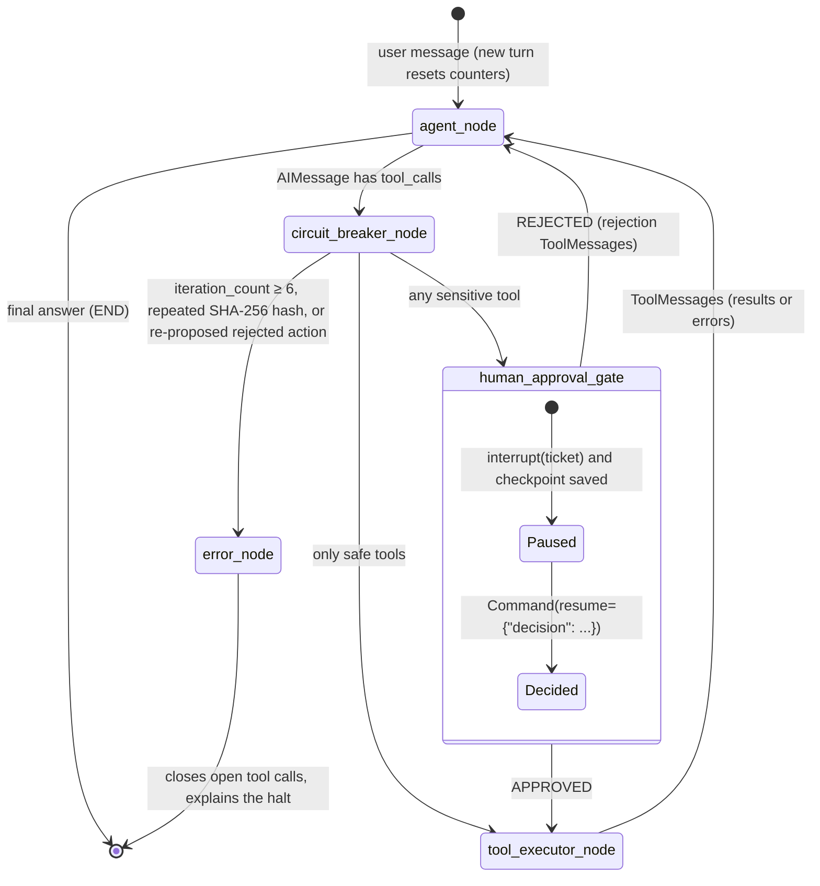

# 🧭 State-Graph ReAct Agent with Memory, Cycle Bounds & Human-in-the-Loop

An internal **Cloud & Financial Operations** agent built on an explicit **LangGraph state machine** instead of a `while True` loop. It reads metrics and balances on its own, but **pauses for a human** before it scales infrastructure or moves money. It remembers each conversation thread, and a **circuit breaker** stops runaway loops within 6 iterations.

- **Live demo:** https://stategraph-patience.streamlit.app
- **Video walkthrough:** https://youtu.be/t0f6qEJZvcU (6:52)

All systems are simulated (no real cluster or bank account is touched).

## State graph



| Node | Job |
|---|---|
| `agent_node` | Calls the LLM (gpt-4o-mini) with the 4 tools bound; increments `iteration_count` |
| `circuit_breaker_node` | Enforces `max_iterations = 6`, the SHA-256 repeat detector, and the "already rejected" block; builds the approval ticket if a sensitive tool is requested |
| `human_approval_gate` | `interrupt()`: saves the checkpoint and suspends the run until a human approves or rejects |
| `tool_executor_node` | Runs the tools; errors become `ToolMessage`s; refuses sensitive tools that are not approved |
| `error_node` | Answers any open tool calls with "NOT RUN", then ends with a clear explanation |

## Project structure

```
stategraph-react-agent/
├── src/
│   ├── state.py            # AgentState TypedDict
│   ├── tools.py            # 2 safe + 2 sensitive tools (+ a failing tool for the breaker demo)
│   ├── circuit_breaker.py  # normalized SHA-256 fingerprints, iteration cap
│   ├── graph.py            # nodes, conditional edges, MemorySaver, send/resume helpers
│   └── app.py              # Streamlit console with state inspector and approval card
└── tests/                  # graph flow, cycle breaker, HITL approval/rejection
```

## Installation & setup

Python 3.11+ and [uv](https://docs.astral.sh/uv/).

```bash
git clone https://github.com/patie03/stategraph-react-agent.git
cd stategraph-react-agent
uv sync
cp .env.example .env      # add OPENAI_API_KEY (no quotes, no spaces)
```

`.env` is git-ignored. On Streamlit Cloud, add `OPENAI_API_KEY = "sk-..."` under **Settings → Secrets**.

## State schema

```python
class AgentState(TypedDict, total=False):
    messages: Annotated[list[AnyMessage], add_messages]   # conversation, appended by the reducer
    iteration_count: int                                  # LLM steps in the current user turn
    executed_tool_hashes: list[str]                       # SHA-256 of tool calls this turn, in order
    rejected_hashes: list[str]                            # sensitive calls the human rejected this turn
    pending_approval: Optional[dict]                      # approval ticket while paused
    approval_status: Optional[Literal["APPROVED", "REJECTED"]]
    halt_reason: Optional[str]                            # why the circuit breaker stopped
```

Nodes only **return partial updates** (`{"messages": [msg], "iteration_count": n + 1}`), never mutate `state`, so every change goes through the reducers and is checkpointed.

## Tools

| Tool | Class | Risk | Notes |
|---|---|---|---|
| `query_service_metrics(service_name)` | ✅ Safe | LOW (Read-only) | error rate, p95 latency, replicas, status |
| `check_billing_balance(account_id)` | ✅ Safe | LOW (Read-only) | ACCT-1001 / 2002 / 3003 |
| `scale_kubernetes_cluster(service_name, replica_count)` | ⚠️ Sensitive | MEDIUM (Infrastructure Mutation) | 1–50 replicas |
| `execute_wire_transfer(recipient_id, amount_usd)` | ⚠️ Sensitive | HIGH (Financial Transaction) | known vendor IDs only, ≤ $25,000, paid from ACCT-3003 |
| `fetch_incident_report(incident_id)` | test only | LOW | always times out; enabled by the UI toggle to demo the breaker |

Each tool carries `metadata = {"is_sensitive": ..., "risk": ...}`. Routing reads that flag; the tool executor checks it again (defense in depth).

## Interruption & resumption protocol

1. **New turn:** `send(graph, text, thread_id)` invokes the graph with the new `HumanMessage` and resets the per-turn counters. The `thread_id` in `config["configurable"]` selects the conversation in the checkpointer.
2. **Safe work runs on its own:** `agent → circuit_breaker → tool_executor → agent …`
3. **Sensitive request:** `circuit_breaker_node` writes an approval ticket to `pending_approval` (tool, arguments, risk) and routes to `human_approval_gate`.
4. **Pause:** the gate calls `interrupt(ticket)`. LangGraph saves the full state to the `MemorySaver` checkpoint and the run returns. `graph.get_state(config).next == ("human_approval_gate",)`. Nothing has run yet.
5. **The UI** reads the ticket from the checkpoint (it survives Streamlit reruns) and shows the approval card. New chat messages are disabled while the thread is paused.
6. **Resume:** `graph.invoke(Command(resume={"decision": "APPROVED" | "REJECTED"}), config)`. LangGraph reloads the checkpoint and re-runs the gate node from the top; this time `interrupt()` returns the decision. There are no side effects before `interrupt()`, so re-running is safe.
7. **Approved** → `tool_executor_node` runs the sensitive tools → `agent_node` reports the results.
   **Rejected** → the gate adds a `ToolMessage` for every pending call ("REJECTED BY HUMAN OPERATOR … do not call this action again") and stores the call's fingerprint in `rejected_hashes`. `agent_node` explains the cancellation. If the model proposes the same action again anyway, the breaker blocks it instead of asking the human a second time.

## Circuit breaker

- **Iteration cap:** if the agent wants more tools when `iteration_count` has reached 6, the run goes to `error_node`.
- **Repeat detector:** `sha256(name + "|" + json.dumps(args, sort_keys=True, separators=(",", ":")))`, with whole-number floats folded (`1500 == 1500.0`) and strings trimmed. Two consecutive calls with the same fingerprint trip the breaker.
- **Valid thread after a halt:** `error_node` answers every open `tool_call_id` with "NOT RUN", so the next message on the thread is still a valid OpenAI request.
- LangGraph's own `recursion_limit` (40) remains as a last-resort backstop.

## Execution

```bash
uv run streamlit run src/app.py     # UI → http://localhost:8501
uv run pytest -v                    # test suite (live LLM tests run when OPENAI_API_KEY is set)
docker compose up --build           # container alternative
```

## Test suite

| Assignment test | Test |
|---|---|
| 1. Safe tool traversal | `test_safe_tool_runs_without_interruption`: path is exactly agent → circuit_breaker → tool_executor → agent → END |
| 2. Multi-turn memory | `test_memory_across_turns_on_same_thread` (Alice), with thread isolation checked |
| 3. Iteration hard bound | `test_iteration_bound_halts_at_six` |
| 4. SHA-256 hash trip | `test_identical_consecutive_calls_trip_the_hash_breaker`, `test_hash_is_normalized` |
| 5. Sensitive interruption | `test_sensitive_action_suspends_at_human_gate` (`next == ("human_approval_gate",)`, nothing executed) |
| 6. Approval resumption | `test_approval_resumes_and_executes` (replicas 4 → 10, balance −$1,500, END) |
| 7. Rejection recovery | `test_rejection_bypasses_tool_and_agent_explains`, `test_reproposing_a_rejected_action_is_blocked_not_reasked` |
| Extra | tool errors returned to the model, counters reset per turn, pause survives a new graph instance, live gpt-4o-mini tests |

The tests use a scripted chat model so they are deterministic and need no key; the graph, checkpointer, `interrupt()`/`Command(resume=...)` and tools are all real.

## AI audit log summary

The baseline was generated with Claude and audited; details and diffs are in [`ai_prompt_log.md`](ai_prompt_log.md).

1. **Crash on import:** the draft used `@tool(metadata=...)`, which LangChain's `@tool` does not accept. Fixed with a small `@tagged(is_sensitive, risk)` decorator.
2. **Thread corruption after a halt:** the specified `error_node` only added a final message, leaving the AI's `tool_calls` unanswered; the next OpenAI request on that thread would be rejected. Fixed by answering every open call with a `ToolMessage`.
3. **Iteration counter never reset:** with a checkpointer, `iteration_count` carried over between user turns, so a thread was blocked after 6 total steps. Fixed by resetting per-turn fields in `new_turn()`.
4. **Rejection loop:** a rejection message alone does not stop a model from asking again. Added explicit wording plus a `rejected_hashes` block in the breaker.
5. **Verified correct:** no in-place state mutation, normalized `sort_keys` hashing, unique `thread_id` per session.

## Deployment

Streamlit Community Cloud, main file `src/app.py`, Python 3.11, secret `OPENAI_API_KEY`. `MemorySaver` keeps threads in memory for the life of the app process; a restart clears them (`SqliteSaver` would make them durable).
